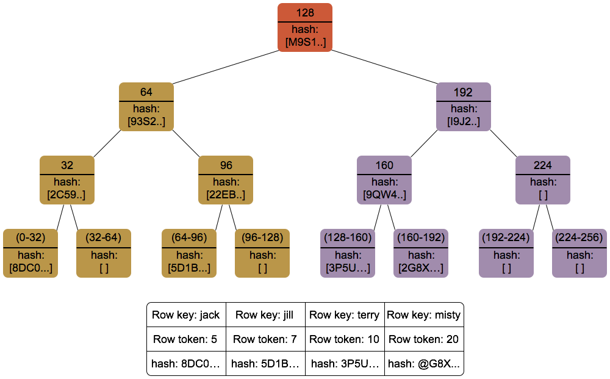

# ДЗ3

Автор: Нечесов Андрей

## Таблица и модель данных

> Объясните, почему партиция по `user_id` и зачем обратный порядок кластеризации 

В задании 3 нам понадобится читать последние события конкретного пользователя. 
 
В этом случае ключ партиции по `user_id` позволяет нам получить все его события обращением только к 1 партиции, которая хранится на узлах полностью. 

Обратный порядок кластеризации нужен, так как мы будем читать именно последние события. 
В данном случае это даст оптимизацию чтения: не придется ничего сортировать на уровне приложения и сканить все SSTable, записи вернутся в нужном порядке.

> Объясните, что произойдёт при двух событиях одного пользователя с одинаковым `event_time`, почему для аудита это риск и как изменить схему, чтобы события не затирались

Из-за того, что `event_time` это ключ кластеризации, событие будет перезаписано и одно из событий потеряется (победит запись с большим writetime, Last Write Wins).
 
Для аудита это риск, так как аудит перестает быть полным - мы не можем быть уверены, что знаем действительно все события, которые происходили с пользователем. Например, мы можем потерять факт покупки, что довольно важно.

Чтобы в разных ситуациях (например, ретраи) различать операции, можем добавить поле `idempotence_key uuid` или любой другой уникальный айдишник операции и учитывать его в ключе кластеризации.  

Тогда `PRIMARY KEY ((user_id), event_time, idempotence_key)`

## Вставка и чтение 

|**Что вставлено**|**Сколько**|**Время**|
|---|---|---|
|События пользователя 1001 (`login`, `purchase`, `view`)|10 000|9.055 с|

Время на вставку 1 записи: 0.0009055 с = 0.91 мс

> Объясните, что даёт PreparedStatement

1. PreparedStatement парсится и компилируетcя один раз, а затем прихранивается в кэш на узле кассандры. Это позволяет увеличить производительность, если у нас много одних и тех же запросов. Например, как в `insert_events` и `read_last`, где мы выполняем в цикле один и тот же запрос, но с разными данными
2. Защищает от инъекций: значение передаются отдельно от запроса. Используем `?` в запросе, где нужно будет подставить значение
3. Дает экономию на сетевом трафике: запрос передается разово, а дальше отправляет только ID стейтмента и данные к нему
4. ответ на PreparedStatement дает также полезную метаинформацию, которую драйвер потом использует. Например, информация по типам и информация по ключам партиционирования, которую можно использовать для отправки запроса сразу на нужный узел. Прочитал вот тут: [ссылка](https://docs.datastax.com/en/developer/java-driver/4.17/manual/core/statements/prepared/index.html#advantages-of-prepared-statements)
   

## Консистентность

|**Уровень**|**Запись, мс**|**Чтение, мс**|
|---|---|---|
|ONE|881 мс|4 мс|
|QUORUM|1207 мс|5 мс|

> Объясните формулу W + R > N. N = 3, replication factor в keyspace `hw3` тоже 3. Опишите, что меняется между ONE и QUORUM для записи и для чтения и какие гарантии даёт QUORUM

Формула определяет условие согласованности чтения  

W - количество узлов, подтвердившие запись  
R - количество узлов ответивших на чтение  

Если W + R > N, то эти множества пересекаются, а значит чтение встретит свежую запись  

В нашем случае:
- ONE + ONE - не дает гарантию, что встретим свежую запись  
- QUORUM (2) + ONE не дает гарантию
- QUORUM (2) + QUORUM (2) > 3 - есть пересечение, встретим свежую запись

Для записи меняется следующее:
1. При ONE нам достаточно ОКа, только от одного узла. Остальные 2 также записывают себе изменения, но ОКа мы от них не ждем
2. При QUORUM ждем подтверждения записи в commit log + memtable от большинства

Для чтения меняется следующее:
1. При ONE запрашиваются данные у 1 реплики
2. При QUORUM координатор запрашивает данные у большинства реплик и возвращает самые свежие данные по writetime 

QUORUM дает следующие гарантии:
1. На запись - данные записаны более чем на один узел. При отказе узла не теряем согласованность данных
2. На запись + чтение - есть пересечение W + R, видим согласованные данные 
   
> Объясните, какой уровень выбрали бы для ленты событий пользователя и почему 

Так как лента представляет аудит, записи важно не потерять, для записи выбрал бы QUORUM   

При чтении аудита хотим видеть актуальные данные (особенно по операциям покупки), поэтому для отображения аудита также оставил бы QUORUM

Ответ: QUORUM на запись и чтение

## Сжатие

|**Таблица**|**Space used(total)**|**SSTable count**|**SSTable Compression Ratio**|
|---|---|---|---|
|`user_actions` (LZ4)|34617|1|0.39099|
|`user_actions_none` (без сжатия)|78523|1|-1.00000|

> Объясните компромисс сжатия: что платится при записи и чтении

При записи и чтении мы увеличиваем нагрузку на CPU: при записи в SSTable надо сжать данные, при чтении блок надо распаковать. Зато мы довольно сильно экономим место на диске, а также ускоряем IO операции с диском. Так, компромисс в том, что мы увеличиваем нагрузку на CPU, но получаем выгоду по занятому месту на диске и в IO операциях

> Почему сжатие выгодно для этого кейса 

События содержат много повторяющихся полей (user_id, event_type). Более того, кассандра сжимает SSTable блоками. При чтении блок распаковывается целиком. Лента-аудит, как правило, читается блоками по N (как раз мы используем LIMIT N в запросе), поэтому из распакованного блока мы сразу получаем пачку нужных событий. Поэтому сжатие выгодно для этого кейса: мы сокращаем занимаемое место на диске и при чтении наша потребность хорошо ложится под механизм

## Bloom-filter

|**Показатель**|**Значение**|
|---|---|
|Bloom filter false positives|0|
|Bloom filter false ratio|0.00000|

> Объясните, что делает bloom-фильтр: почему при обращении к отсутствующему в таблице ключу disk lookup не нужен

Bloom-фильтр создается на каждый SSTable и помогает определить, есть ли в этом SSTable конкретный ключ партиции. Bloom-фильтр либо говорит, что ключа точно нет, либо что он может там быть.  

Bloom-фильтр заполняется один раз при записи файла и хранится в памяти узла. Поэтому если каждый из Bloom фильтров для соответствующей SSTable дал false результат по наличию в ней ключа, то операций с диском не будет.

> Объясните, что означает метрика и когда bloom-фильтр полезен, а когда не важен

`Bloom filter false positives` метрика показывает, сколько раз фильтр Блума дал ложноположительный результат, а `Bloom filter false ratio` показывает сколько ложноположительных запросов было по отношению к общему количеству запросов к фильтру. 

bloom-фильтр полезен, когда мы ищем данные по конкретному partition key.
В случаях, когда у нас нагрузка на чтение сильно реже нагрузки на запись или если мы часто используем поиск по диапазону (без partition key, например поиск по всем пользователям за конкретный event_time период), bloom фильтр мало важен

## Repair

> Что такое anti-entropy и зачем нужен `nodetool repair`

У механизмов read repair и hinted handoff есть свои границы. Read repair, как следует из названия, работает только на пути чтения. То есть если расхождение возникло у ключа без запросов, оно может жить неопределенно долго. Hinted handoff работает при записи и в рамках окна (по дефолту это 3 часа) после этого окна записи теряются. 

anti-entropy repair (запускается через nodetool repair) - это механизм восстановления согласованности данных между репликами. Он нужен, чтобы чинить расхождения, которые не покрывают read repair и hinted handoff. Запускается по расписанию и по событиям

Механизм anti-entropy находит расхождения за счет Merkle-tree, построенных на узлах  
Если корень совпал - данные совпадают, иначе ищем в каком диапазоне они расходятся.

> Когда без repair не обойтись и что происходит при долгой работе без него

При наличии реплик периодический repair нужен в любом случае. В особенности без него не обойтись при длительной недоступности реплики или нескольких реплик  

При долгой работе без repair можем наблюдать:
- возврат устаревших данных, если делаем запросы с consistency=ONE и запрос идет на отставшую реплику 
- расхождения tombstones, в результате которых можем получить воскрешение данных. 

Пример хронологии воскрешения из лонгрида:

1. день ноль - удаление, маркер записан на две реплики, третья недоступна; 
2. дни один-десять - маркер жив, копия третьей реплики подавляема; 
3. день десять - маркеры на первых двух репликах сжаты;
4. день пятьдесят - третья реплика возвращается после длительного восстановления со старыми данными, и ни один механизм не может определить, что её копии устарели

> Чем repair отличается от read repair и hinted handoff

Hinted handoff предназначен для восстановления согласованности **на коротких простоях** (по дефолту до 3 часов). Он прихранивает записи в лог, а затем повторяет их на отставшем узле. Граница Hinted handoff - это время простоя, все что старше окна лога - уже не восстанавливается.

Read repair предназначен для восстановления согласованности **на пути чтения**. То есть если координатор обнаруживает при чтении на реплике/репликах отставание, он отправляет реплике/репликам свежую версию. Граница - читаемые данные. То есть если данные не вычитываются, этот механизм их и не восстановит

Anti-entropy repair нужен для покрытия всех диапазонов. Он тяжелее, но и не работает постоянно, в отличие от Hinted handoff/Read repair

## TTL и компакция

Результаты трейсинга в файле `tombstone-tracing.txt`

> Почему TWCS подходит журналу событий, а STCS - нет

STCS группирует SSTable по размеру. Так, в какой-то момент оказывается, что в одном большом SSTable находятся как свежие события, так и старые, которые не читаются. При удалении нужно ожидать, пока накопятся ещё SSTable похожего размера - это приводит к тому, что много лишних данных копятся на диске.

TWCS же группирует события по временным окнам. SSTable одного временного окна не смешиваются с SSTable других окон

> Как TTL соотносится с gc_grace_seconds

Чтобы удаление прошло корректно и не было ситуации с воcкрешением записей, нужно чтобы tombstones добрались до всех реплик и достигли согласованного состояния. gc_grace_seconds как раз определяет период, за который tombstones ожидаемо доберутся до согласованного состояния и после которого tombstones можно будет удалять в процессе compaction.  

TTL соотносится тем образом, что после истечения TTL создается tombstone, запись перестает быть видна при чтениях, а далее tombstone исчезает только после gc_grace_seconds

> Почему TTL предпочтительнее массового DELETE

Массовый Delete требует создания большого количества маркеров, это приводит к большим накладным расходам в моменте и участвует в чтении, записи и compaction. Если мы знаем, что данные нужно будет когда-то удалить, следует использовать TTL механизм, так получится "порционно" распределить нагрузку
